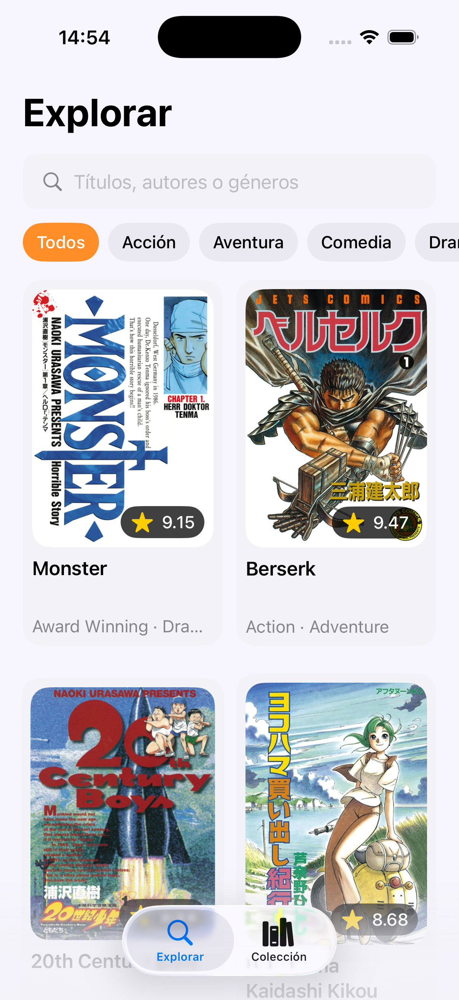
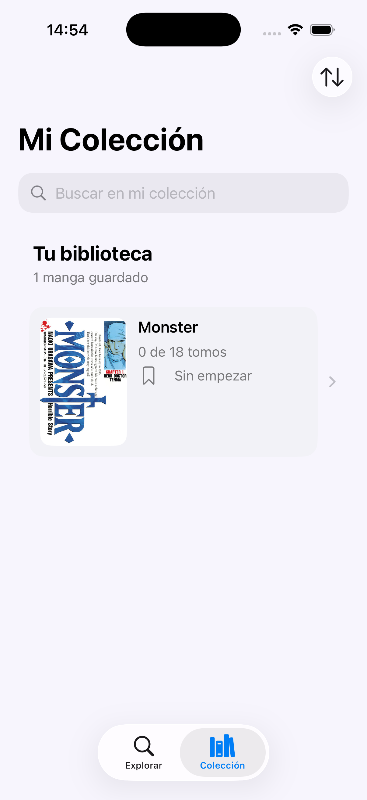
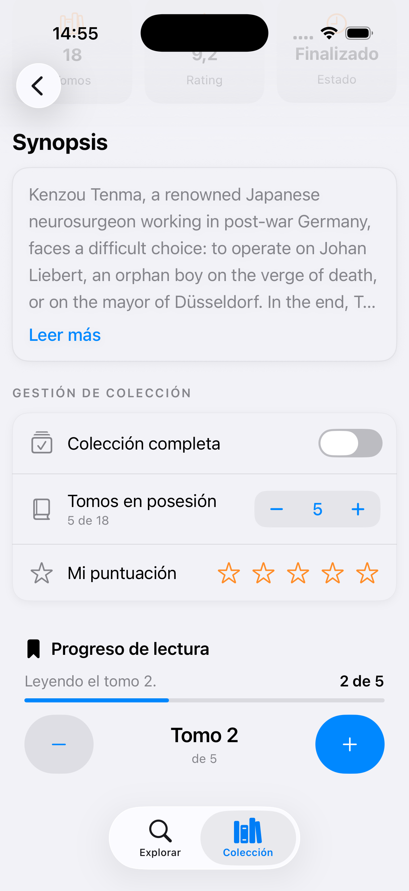

# 📚 MangaHub

### Discover manga. Build your collection. Track your reading journey.

**MangaHub** is a native iOS application built with **Swift and SwiftUI**, designed to help manga enthusiasts explore titles, organize their personal manga collection, and keep track of their reading progress.

The application integrates with a REST API to retrieve manga information and uses modern Apple development technologies to deliver a native iOS experience.

This project was developed to put iOS development concepts into practice, with a focus on application architecture, API integration, data persistence, and asynchronous programming.

---

## 📱 Screenshots

| Explore | Collection | Reading Progress |
|:---:|:---:|:---:|
|  |  |  |

---

## ✨ Features

### 🔎 Manga Discovery
- Explore manga titles through an external REST API.
- Access manga information retrieved from the API.

### 📚 Personal Collection
- Add manga to a personal collection.
- Organize and manage saved manga titles.

### 📖 Reading Progress
- Keep track of reading progress.
- Manage reading progress across your personal collection.

---

## 🛠 Tech Stack

MangaHub is developed using Apple's native iOS development ecosystem.

| Technology | Purpose |
|---|---|
| **Swift** | Primary programming language |
| **SwiftUI** | Declarative user interface |
| **SwiftData** | Data persistence |
| **Swift Concurrency** | Asynchronous operations |
| **URLSession** | REST API communication |
| **MVVM** | Application architecture |

---

## 🏗 Architecture

MangaHub follows the **Model–View–ViewModel (MVVM)** architectural pattern, promoting separation of responsibilities and maintainable code.

### Model
Represents the application's data and domain entities.

### View
Defines the user interface using SwiftUI.

### ViewModel
Manages presentation logic and connects the user interface with application data and operations.

### Architectural Overview

```text
             ┌─────────────────┐
             │      View       │
             │     SwiftUI     │
             └────────┬────────┘
                      │
             ┌────────▼────────┐
             │    ViewModel    │
             │ Presentation    │
             │     Logic       │
             └────────┬────────┘
                      │
             ┌────────▼────────┐
             │      Model      │
             │   Application   │
             │      Data       │
             └─────────────────┘
```

The application also uses URLSession for network communication, Swift Concurrency for asynchronous programming, and SwiftData for data persistence.

---

## 🌐 REST API Integration

MangaHub integrates with an external REST API to retrieve manga information.

The application uses:

- **URLSession** for HTTP networking.
- **Swift Concurrency** for asynchronous operations.
- **Swift** for processing and managing application data.

**API Provider:** 

---

## 💾 Data Persistence

MangaHub uses **SwiftData**, Apple's native persistence framework, as part of its data management implementation.

This enables the application to work with persistent data within the Apple development ecosystem.

---

## 🚀 Getting Started

### Prerequisites

Before running MangaHub, make sure you have:

- A Mac with Xcode installed.
- An iOS Simulator or a compatible physical device.
- Git installed.

**Minimum iOS version:** iOS 26

### Installation

**1. Clone the repository**

```bash
git clone https://github.com/alvaarofdez20/MangaHub.git
```

**2. Navigate to the project directory**

```bash
cd MangaHub
```

**3. Open the project in Xcode**

Open the `.xcodeproj` file, or the `.xcworkspace` file if your project uses one.

**4. Build and run**

Select a compatible iOS Simulator or device and press:

`⌘ + R`

**Note:** Additional configuration may be required depending on your project's API setup and signing settings.

---

## 🎯 Project Goals

MangaHub was created to strengthen practical skills in native iOS application development.

The main development goals include:

- Building interfaces with SwiftUI.
- Applying the MVVM architectural pattern.
- Integrating external REST APIs.
- Working with asynchronous operations using Swift Concurrency.
- Managing data persistence with SwiftData.
- Structuring and maintaining an iOS application.

---

## 👨‍💻 Author

Developed by Álvaro Fernández de Cordova Orta

iOS Developer | Swift & SwiftUI

- **GitHub:** alvaarofdez20
- **LinkedIn:** www.linkedin.com/in/alvaarofdez20

---

## 📄 License

No license has been specified for this repository.

All rights are reserved unless a license is added.

---

### ⭐ Thanks for visiting!

If you find this project interesting, consider giving the repository a star.

Feedback and suggestions are always welcome.
